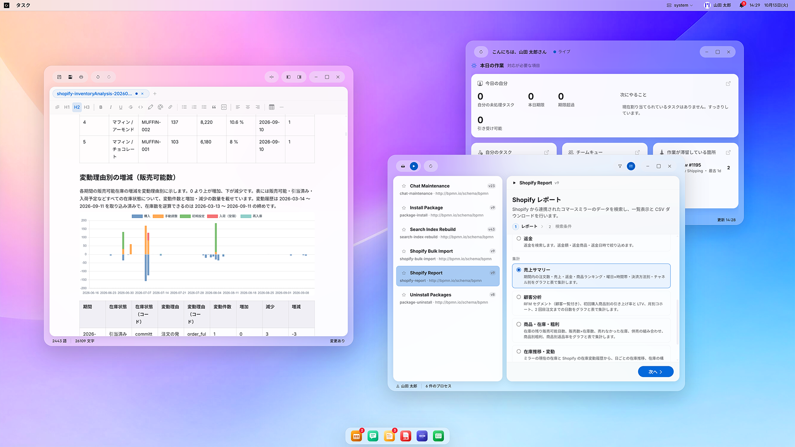

# MintJams Webtop (AI-Ready CMS & Business Workspace)

**An AI-native, self-hosted CMS and virtual desktop built for small businesses and local shops.**

Manage your website, documents, inventory, and daily workflows in a familiar OS-like browser desktop—or simply ask your AI assistant (like Claude Desktop) to update your site for you via the built-in **MCP (Model Context Protocol) server**.



## ✨ Why MintJams?

- **🤖 AI-Ready with Built-in MCP Server:** Connect Claude Desktop or any MCP-compatible AI assistant directly to your CMS. Just say, *"Add an autumn limited menu page to our cafe website using the photos I just uploaded,"* and the AI handles the rest.
- **🖥️ Intuitive "Webtop" Experience:** No complicated admin panels. Organize content, edit documents, preview PDFs, and check Shopify analytics (requires an extension package) in a clean, multi-window virtual desktop right in your browser.
- **🏪 Designed for Small Businesses & Shops:** Everything you need to run a shop or small company in one place—content management, task workflows (BPMN), and commerce reporting (requires an extension package).
- **🔒 Enterprise-Grade Security, Zero Config:** Includes built-in Passkey (WebAuthn), TOTP two-factor authentication, and SAML 2.0 out of the box—no complex setup required.

---

## Quick start (Docker)

The published image bundles the full server runtime, all default bundles, and
the pre-built Webtop assets. The only required configuration is the external
URL the CMS will be reachable on.

```bash
docker run --rm \
  -p 8080:8080 \
  -e CMS_PUBLIC_BASE_URL=http://localhost:8080 \
  -v cms-repository:/data/repository \
  -v cms-secrets:/data/secrets \
  -v cms-index:/data/index \
  mintjams/cms:0.2.0
```

Then open <http://localhost:8080/> in a browser.

For a fixed deployment behind a reverse proxy, set `CMS_PUBLIC_BASE_URL` to the
externally visible URL (e.g. `https://cms.example.org`) so the SAML SP and IdP
generate correct redirect URLs.

### docker compose

```yaml
services:
  cms:
    image: mintjams/cms:0.2.0
    restart: unless-stopped
    environment:
      CMS_PUBLIC_BASE_URL: "http://localhost:8080"
    ports:
      - "8080:8080"
    volumes:
      - cms-repository:/data/repository
      - cms-secrets:/data/secrets
      - cms-index:/data/index

volumes:
  cms-repository:
  cms-secrets:
  cms-index:
```

---

## First login

On the **first** start, the container generates a random password for the
built-in `admin` user and writes it (mode `0600`) into the repository volume.
Read it from the host:

```bash
docker exec <container> cat /data/repository/INITIAL_PASSWORD.txt
```

Log in as `admin` with that password, change it via Preferences, then delete
the file:

```bash
docker exec <container> rm /data/repository/INITIAL_PASSWORD.txt
```

To set the initial password explicitly instead, pass
`-e CMS_INITIAL_ADMIN_PASSWORD=...` on the first run.

---

## Configuration

### Environment variables

| Variable | Required | Purpose |
|---|---|---|
| `CMS_PUBLIC_BASE_URL` | **yes** | External base URL (e.g. `https://cms.example.org`). Drives the SAML SP `rootURL` and IdP `baseUrl`. The container refuses to start without it. |
| `CMS_INITIAL_ADMIN_PASSWORD` | no | Initial password for the auto-created `admin` user. If unset, a random password is generated and written to `/data/repository/INITIAL_PASSWORD.txt`. |
| `CMS_SP_KEYSTORE_PASSWORD` | no | Password for the auto-generated SP keystore. If unset, a random one is generated and written to `/data/repository/SP_KEYSTORE_PASSWORD.txt`. Stored AES-encrypted in `etc/saml2.yml` either way. |
| `CMS_IDP_KEYSTORE_PASSWORD` | no | Password for the auto-generated IdP keystore. If unset, a random one is generated and written to `/data/repository/IDP_KEYSTORE_PASSWORD.txt`. Stored AES-encrypted in `etc/idp.yml` either way. |
| `MINTJAMS_CMS_SECRET_KEY_PATH` | no | Path to the AES master key. Defaults to `/data/secrets/secret-key.yml` in the image (`<repository>/etc/secret.key` outside it). Passwords and API keys themselves go into `etc/secrets.yml`, which the server keeps encrypted; see [`documents/secrets.md`](documents/secrets.md). |
| `CMS_CLUSTER_ENABLED` | no | `true` or `false`. Selects the clustered or standalone configuration files placed on first start, and when set overrides `etc/repository.yml`. See [`docker/README.md`](docker/README.md#bundled-assets-and-configuration). |
| `CMS_DB_HOST`, `CMS_DB_PORT`, `CMS_DB_USER`, `CMS_DB_PASSWORD` | cluster | The shared database the clustered configuration files point at. `CMS_DB_PASSWORD_FILE` reads the password from a file (a Docker secret) instead. See [`docker/README.md`](docker/README.md#configuration-values-from-the-environment). |
| `CMS_SEARCH_INDEX_PATH` | no | Where this node keeps its search index. Defaults to `/data/index`. Node-local — never shared storage. |
| `CMS_JAVA_OPTS` | no | Extra JVM flags (e.g. `-Xmx4g`), appended to the image's own. Set this rather than `JAVA_TOOL_OPTIONS`, which replaces what the entrypoint assembles. |

A configuration file can take a value from the environment with
`${env.NAME}` (or `${env.NAME:-default}`), from a file with `NAME_FILE`, or
carry it encrypted as `ENC[v1:...]` — see
[`docker/README.md`](docker/README.md#configuration-values-from-the-environment).

### Persistent volumes

| Mount | Why it must persist |
|---|---|
| `/data/repository` | JCR content, generated SP/IdP keystores (`*.p12`), and the auto-generated `etc/saml2.yml` / `etc/idp.yml`. Losing this means starting from an empty repository. |
| `/data/secrets`    | The AES master key that encrypts keystore passwords in the YAML files and any `ENC[...]` value. **Losing this volume makes those encrypted values unrecoverable.** Back it up separately. |
| `/data/index`      | This node's search index. Rebuilt automatically from the repository content when empty, so it need not be backed up — but it must stay node-local. |

### Exposed port

| Port | Description |
|---|---|
| `8080` | HTTP. Terminate TLS at a reverse proxy and forward to this port. |

### Behind a reverse proxy

The HTTP service reads the forwarding headers of a request and answers as if
the client had connected to it directly: the scheme, host, port and client
address the CMS sees — and the redirects it sends — are the ones the proxy
reports. This is turned on by one line in `conf/config.properties`, which the
image ships with:

```properties
org.apache.felix.proxy.load.balancer.connection.enable=true
```

Without it the CMS takes every request for plain HTTP on its own port, and
redirects lead to the wrong address.

| Header | What the CMS takes from it |
|---|---|
| `X-Forwarded-Proto` | The scheme (`https`). |
| `X-Forwarded-Host` | The host name, in place of `Host`. |
| `X-Forwarded-Port` | The port. |
| `X-Forwarded-For` | The client address. |
| `Forwarded` | All of the above, in the standard form. |

The proxy has to pass `Host` as the client sent it and set `X-Forwarded-Proto`.
These headers are trusted as they arrive, so the proxy should set or remove
each of them itself instead of passing on what a client sent, and port 8080
should be reachable only from the proxy.

#### Client certificates

A proxy that asks the browser for a client certificate can hand the
certificate to the CMS in a header. The bundled SSL filter
(`org.apache.felix.http.sslfilter`) then places it in the request attribute
`javax.servlet.request.X509Certificate`, where a script finds it as it would
on a direct TLS connection. Nothing in the CMS reads that attribute by itself;
this is for your own scripts.

The filter does nothing until it is configured. In the OSGi Console, open the
configuration with the PID `org.apache.felix.http.sslfilter.SslFilter` and set:

| Property | Value |
|---|---|
| `ssl-forward.header` | `X-Forwarded-Proto` |
| `ssl-forward.value` | `https` |
| `ssl-forward-cert.header` | The header the proxy puts the certificate in. `X-Forwarded-SSL-Certificate` by default. |

Two things to get right at the proxy:

- **The form of the certificate.** The filter reads a PEM certificate written
  on one line, with a space where each line break was. A URL-encoded
  certificate is not accepted: the filter logs the failure and the request
  goes on without a certificate.
- **The port.** Once the filter is configured, it reports port 443 for every
  forwarded request unless the proxy sends `X-Forwarded-Port`. Send that
  header when the CMS is published on another port.

### Zero-configuration SAML

On first boot the bundles create `etc/saml2.yml`, `etc/idp.yml`, and both
keystores automatically. The SP trusts the co-located IdP via in-JVM OSGi
services — no manual metadata exchange is required. `CMS_PUBLIC_BASE_URL`
is the single source of truth for the external hostname; restarting with a
new value retargets both SP and IdP. To federate with an external IdP, edit
`etc/saml2.yml` after first boot; values written there take precedence over
the auto-generated defaults.

### Sign-in methods and second factors

The built-in IdP offers three ways to sign in, chosen on the login page:

- **Passkey** (WebAuthn): face or fingerprint recognition, a device PIN, or
  a security key. Passkeys are registered as discoverable credentials with
  user verification, so no user name is typed and a passkey alone counts as
  two factors.
- **Password**, followed by a 6-digit code from an authenticator app when
  the user has turned on two-step verification (TOTP, RFC 6238). Ten
  single-use backup codes are issued with it for when the app is not at
  hand.
- **A code sent by email**: a 6-digit code goes to the address on the
  account, valid for five minutes and once. Only an address the user has
  confirmed (by entering a code sent to it in Preferences › Profile)
  receives sign-in codes; an address an administrator enters waits for
  that confirmation. It needs the outgoing mail transport (`etc/mail.yml`,
  see [`documents/mail-transport.md`](documents/mail-transport.md)) and is
  followed by the authenticator code too when TOTP is on. An administrator
  can turn passwords off and leave this as the way in; see
  [`documents/sign-in-methods.md`](documents/sign-in-methods.md). The texts
  of these messages can be rewritten per language in
  `/etc/mail/templates`; see
  [`documents/mail-templates.md`](documents/mail-templates.md).

Users manage the second factors in **Preferences › Security** (turn TOTP on or off, get
new backup codes and download them, add, rename and remove passkeys). Every
step that starts an enrollment or weakens a sign-in asks for the current
password again. An administrator can turn off a user's TOTP and remove their
passkeys for account recovery from the **Identity Manager** (user › Security),
or through the GraphQL mutations `disableTotp` and `deletePasskey`; neither
needs the user's password.

The SAML assertion tells the SP how the user authenticated
(`AuthnContextClassRef`: `PasswordProtectedTransport`, `TimeSyncToken`,
`urn:mintjams:idp:ac:classes:WebAuthn`, `urn:mintjams:idp:ac:classes:EmailCode`
or `urn:mintjams:idp:ac:classes:EmailCodeTimeSyncToken`), and the SP records
the factors in the session and the authentication token (`saml2,password`,
`saml2,password,totp`, `saml2,webauthn`, `saml2,emailCode`,
`saml2,emailCode,totp`).

`etc/idp.yml` settings (all optional; the defaults are written on first
boot):

| Key | Default | Purpose |
|---|---|---|
| `signIn.password` | `true` | Offer username and password. `false` is honoured only while a code sent by email can be offered; otherwise passwords stay on and the log says so. `CMS_IDP_ALLOW_PASSWORD=true` (or `-Dcms.idp.allowPassword=true`) turns them back on for one run. |
| `signIn.emailCode` | `true` | Offer a code sent to the user's email address. Needs `etc/mail.yml`. |
| `webauthn.rpId` | host of `baseUrl` | The WebAuthn relying-party id. Passkeys are bound to it; changing it invalidates every registered passkey. Leave blank unless the IdP is served under a different host than the one users see. |
| `webauthn.rpName` | `MintJams` | The name authenticators show when a passkey is created. |
| `webauthn.origins` | `[]` | Extra origins allowed to run WebAuthn ceremonies. The origin of `baseUrl` is always allowed. |
| `totp.issuer` | `MintJams` | The issuer shown in authenticator apps. |
| `customLoginPageUrl` | (unset) | Serve your own login page instead of the bundled one; see below. |

Password hashes, TOTP secrets, backup codes and passkeys live in the system
workspace under `/home/credentials`, which denies every privilege to
`everyone`; only system, service and administrator sessions can read it.
User profiles under `/home/users` carry no credentials.

### Branding the login page

The login page is a small single-page application: the sign-in flow
(method choice, password, verification code, passkey) is served by the IdP
at `/idp/login/app.js` and renders itself into an element with the id
`idp-login`; the page around it is yours. Start from the bundled template,
which the Webtop ships at `/content/public/auth/login.html` in the system
workspace (reachable as
`/bin/cms.cgi/system/content/public/auth/login.html`). Copy it to a path of
your own first — the bundled file is a seed asset, and a later release
replaces it in place, so edits made to it are lost on upgrade. In the copy,
change the logo, colours (the `--idp-*` custom properties theme the flow),
background and footer, keep the `idp-login` element and the module script,
and point the IdP at the copy:

```yaml
customLoginPageUrl: /bin/cms.cgi/system/content/public/auth/my-login.html
```

Because the flow lives in `app.js`, a branded page keeps working when a
later release adds a step.

The flow is in English and Japanese. It picks the language in this order:
`window.IDP_LOGIN.lang`, the visitor's own choice (localStorage key
`idp.login.lang`), `<html lang>` when the page sets one, then the browser's
preferred languages; English when none matches. The bundled page offers the
switch in its footer by writing that key and reloading, and translates its
own frame (title, heading, footer) from a small table inline in the HTML
when the flow reports the language in the `idp-login-ready` event's
`detail.lang`. Server errors carry a `code`; the flow shows its own label
for the code and falls back to the server's English `message` otherwise.
`window.IDP_LOGIN = { lang, labels, mount }` set before the script loads
pins the language, overrides individual labels, or changes the mount
element.

---

## Upgrading

From **0.1.24-beta** on, upgrading means replacing the image and keeping the
volumes. On every start, the bundled content (Webtop apps, built-in
provisioning, and the other default content shipped with the image) is
brought in line with the running image in every workspace, including the
removal of files the image no longer ships. Configuration files in the
repository volume (`etc/*.yml`, `<workspace>/etc/**/*.yml`) are written only
when missing and never overwritten; settings introduced by a later release
use their defaults until you set them.

### Installations of 0.1.23-beta or earlier

These releases copied the bundled content into the repository volume only
when the volume was first created, so replacing the image never updated it.
They cannot be upgraded in place. Install 0.1.24-beta or later on new, empty
volumes instead:

1. In the old installation, export the content you want to keep as a CMS
   Archive from the Content Browser.
2. Start the new version with new volumes for `/data/repository` and
   `/data/secrets`. A new `admin` password is generated (see
   [First login](#first-login)).
3. Import the archives in the new installation's Content Browser, and reapply
   any changes you made to configuration files (for example an external IdP in
   `etc/saml2.yml`).

Until 1.0, a release may again require a fresh installation; such releases
are announced in this section.

### Installations before the credential store

The release that introduced passkeys and two-step verification moved
password hashes out of the user profiles into `/home/credentials` (see
[Sign-in methods and second factors](#sign-in-methods-and-second-factors)).
Passwords stored on profiles by earlier releases are not read any more, so
nobody, `admin` included, can sign in to an upgraded repository. Install
this release on new, empty volumes following the steps above.

### EIP routes that used `cms:` value operations

The `cms:` route component no longer has the operations that read and wrote
content: `createFolder`, `createFile`, `getMimeType`, `setMimeType`,
`GetEncoding`, `SetEncoding`, `load`, `getContent`, `store`, `getProperty`,
`setProperty`, `getProperties`, `setProperties`, `move`, `exists`, `query`,
`list`, `remove`, `addVersionControl`, `checkout`, `checkin`, `uncheckout`
and `checkpoint`. Routes do this work in `<script><groovy>` nodes through the
script API instead, as the bundled routes always have. `cms:login`,
`cms:commit`, `cms:rollback`, `cms:logout`, `cms:lock`, `cms:unlock` and
`cms:<path>` for running a script remain.

A route that still names one of the removed operations deploys, but fails on
its first message with "Resource not found" because an unknown operation is
read as the path of a script. Search your route files for `cms:` and rewrite
each such node before upgrading.

---

## Maintenance

### Rebuilding the search index

Administrators can rebuild the full-text search index from the Webtop
**Tasks** app (*Start a process* → **Search Index Rebuild**) — for
example after changing the search configuration under
`<workspace>/etc/search`. The rebuild runs in the background on every
cluster node while search and content updates keep working; a progress
task shows every node live and supports abort and re-running failed
nodes. See
[`documents/search-index-rebuild.md`](documents/search-index-rebuild.md).

### Installing packages

Administrators install applications and extensions into a workspace from
the Webtop **Tasks** app (*Start a process* → **Install Package**) from a
package file: a ZIP with a `package.yml` manifest, the files to place
under `deploy/`, the provisioning to apply under `provisioning/` and,
optionally, the images that present the package under `images/`. The
manifest can carry its texts in several languages, a category, tags, a
home page and a license. The package is read and checked first (manifest,
layout, platform version, dependencies, version, reserved paths,
provisioning, images); a confirmation task shows what it is and what
installing it does before anything is written. Installing a
newer version upgrades in place and removes what the previous version
placed and the new one no longer ships. **Uninstall Packages** lists the
installed packages, lets several be selected, checks that nothing left
behind requires them, and removes what they placed. See
[`documents/packages.md`](documents/packages.md).

---

## Platform support

The published image is a **multi-arch manifest covering `linux/amd64` and
`linux/arm64`**. Docker automatically pulls the variant matching the host, so
Apple Silicon and arm64 servers run natively — no emulation required. Native
JavaScript support (V8 via JNI) is delivered by per-architecture fragment
bundles (`org.mintjams.rt.cms.linux.x86_64` and
`org.mintjams.rt.cms.linux.arm64`); the runtime loads the libraries for the
running architecture and ignores the rest. See
[`docker/README.md`](docker/README.md#platform-support) for details.

---

## Repository layout

```
bundles/    Server-side OSGi bundles (JCR, CMS, SAML SP/IdP, Camel, Camunda, ...)
webtop/    Client-side virtual desktop and built-in apps (TypeScript + Rollup)
docker/    Dockerfile, entrypoint, compose example, image seed (bundled assets, default configuration)
scripts/   docker-build.sh / docker-build.ps1 wrappers around `docker buildx`,
           assemble-seed.sh / assemble-seed.ps1 to lay the Webtop into the seed
```

## Building from source

The published image is produced from this repository. If you want to build it
yourself (custom bundles, private fork, etc.), see
[`docker/README.md`](docker/README.md) for the full build pipeline:

1. Produce a `felix-dist/` directory at the repo root (Felix runtime + the
   bundles compiled from `bundles/`).
2. Build the Webtop (`cd webtop && npm run build:prod`) and run
   `./scripts/assemble-seed.sh` (or the PowerShell equivalent) to lay it into
   `docker/seed/`.
3. Run `./scripts/docker-build.sh -v <version>` (or the PowerShell
   equivalent) to produce a `mintjams/cms:<version>` image.

Per-component build instructions live in [`webtop/README.md`](webtop/README.md)
for the client and in each bundle's own metadata for the server.

---

## License

MIT. See [`LICENSE`](LICENSE) for the project and
[`docker/THIRD_PARTY_LICENSES.md`](docker/THIRD_PARTY_LICENSES.md) for the
inventory of third-party software shipped inside the container image.

## Links

- Docker Hub: <https://hub.docker.com/r/mintjams/cms>
- Source: <https://github.com/mintjamsinc/cms0>
- Vendor: <https://www.mintjams.jp/>

## Trademarks

All trademarks are the property of their respective owners.

---

Built with ❤️ by [MintJams Inc.](https://www.mintjams.jp/)
